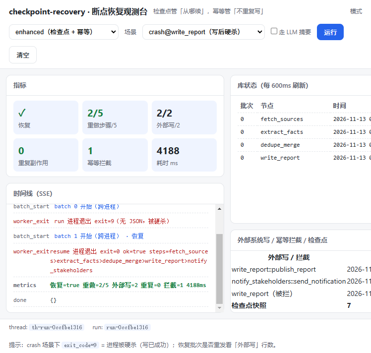

# checkpoint-recovery · 长任务断点恢复

> 功能与踩坑详见项目根 `过程文档.md`。

一个能跑的「长任务断点恢复」项目，核心口径全部落成可测的代码：

1. **检查点只负责「从哪继续」，不负责「不重复写」。** 崩溃恢复时重复副作用靠幂等拦住，二者缺一不可——恢复成功率、重做步骤数、重复副作用次数是三个独立指标。
2. **幂等副作用注册表**：真实外写（发布报告、发通知）按业务键 `INSERT OR IGNORE`，同键第二次被拦截并留痕，拦截记录是重复写的预警信号。
3. **durability 三档对照**：`sync` 每步落盘、`async` 小概率丢最近一步、`exit` 崩溃时中间态全无——三档在同一个崩溃现场的表现差别就是检查点选型的依据。
4. **四形态故障注入**：`raise`（节点处理错误）、`write_fail`（外写超时）、`crash`（外写后硬杀进程，跨进程）、无故障——最恶劣的是「写成功了但进程挂了」。

上层是 LangGraph 五步流水线（fetch → extract → dedupe → write → notify），恢复走 `invoke(None)` 从检查点续跑；对照实验 baseline（无检查点无幂等）与 enhanced（检查点 + 幂等）各跑 3 次，四项指标直接落表。

## 快速开始

```bash
cd checkpoint-recovery
pip install -r requirements.txt

# 机制自测（不碰 LLM，临时库，11 个用例）
python -m src.selftest

# 端到端检查（过 LLM：真实摘要 + 故障恢复 + 幂等断言）
python -m src.agent_check

# 命令行演示（clean → raise 恢复 → crash 恢复 → baseline 对照 → exit 档对照）
python -m src.cli demo

# 对照实验（4 场景 × 2 模式 × 3 次，出表存 runs/）
python -m src.cli experiment

# 浏览器观测台（指标 / SSE 时间线 / 库状态 / 外部写 / 幂等拦截 / 检查点）
python -m src.server     # http://127.0.0.1:8622
```

模型走 `.env`（OpenAI 兼容接口），默认 `gpt-4o-mini`；`extract_facts` 默认走规则摘要，零网络可跑，`--llm` 才过模型。

## 目录结构

```
checkpoint-recovery/
├── src/
│   ├── config.py       # 路径、.env 加载、模型装配
│   ├── state.py        # ReportState 定义（run_id 贯穿全批次）
│   ├── side_effects.py # 幂等副作用注册表 + 外部写日志 + 节点执行日志
│   ├── faults.py       # 故障注入三形态（crash / raise / write_fail）
│   ├── seeds.py        # 真实语料（5 篇技术文档段落）
│   ├── pipeline.py     # LangGraph 五步流水线（外写统一过幂等）
│   ├── runner.py       # 场景运行器（指标汇总，SSE 事件回调）
│   ├── _worker.py      # 跨进程 worker（crash 场景：exit 9 / resume 续跑）
│   ├── experiment.py   # 4 场景 × 2 模式对照实验
│   ├── selftest.py     # 11 个机制自测（纯离线断言，不碰 LLM）
│   ├── agent_check.py  # 3 项端到端检查（过 LLM）
│   ├── cli.py          # demo / experiment / selftest 命令行
│   └── server.py       # FastAPI + SSE 观测台后端
├── static/index.html   # 单页观测台前端
├── attachments/        # 冒烟截图（观测台界面证据）
├── runs/               # 运行日志与对照实验结果（随项目入库）
├── data/               # 观测台演示数据（不入库）
└── .env                # 模型配置（不入库）
```

## 核心指标

| 指标 | 含义 | 期望值 |
|---|---|---|
| 恢复成功率 | 故障后能否跑完全部 5 步 | 100%（两种模式都应成功） |
| 重做步骤数 | 恢复批次实际执行的节点数 | baseline 恒 5；enhanced 只跑失败节点及后续 |
| 外部写次数 | 外部系统实际收到的写 | 恰好 2（发布报告 + 发通知） |
| 重复副作用次数 | 外部写次数 − 期望次数 | enhanced 0；baseline crash 场景 = 1（真实损失） |
| 幂等拦截次数 | 被注册表拦下的重复写 | enhanced crash 场景 ≥ 1，是 dup=0 的原因 |

## 演示端接口

| 接口 | 作用 |
|---|---|
| `GET /` | 单页观测台 |
| `POST /api/run` | SSE 流：`batch_start` / `node` / `batch_end` / `worker_exit` / `metrics` / `error` |
| `GET /api/state` | 当前 run 的 node_runs / external_writes / dup_blocks / 检查点数 |

2026-11-13 冒烟（enhanced + crash 场景：exit 9 硬杀 → 续跑恢复，重做 2 步、重复 0、拦截 1）：



## 已知边界

- 检查点底座是 SQLite（`SqliteSaver`），单文件够演示；换 Postgres 只换 checkpointer 类，不动流程与幂等口径。
- `crash` 场景靠跨进程 `os._exit(9)` 模拟 SIGKILL；同进程无法注入（会杀死调用方）。
- 恢复语义要求 `invoke(None)`；给恢复批次传新输入会被当成新任务重跑 START。
- `durability=exit` + 硬杀的组合没有中间快照，恢复只能整链重跑——这是选型代价，不是缺陷。
- 数据落在 `data/`（观测台）与 `runs/`（日志），删掉即重置；对照实验之间检查点文件互删，保证干净起点。
